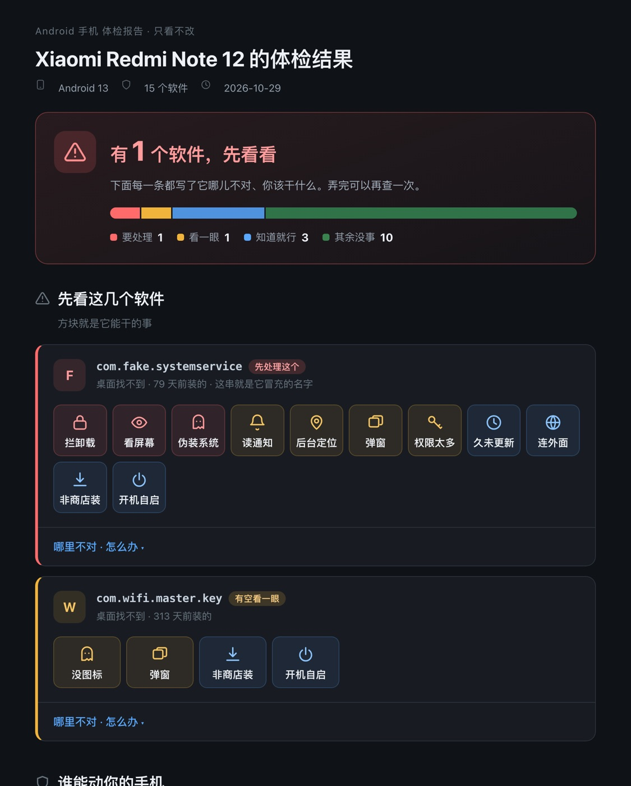
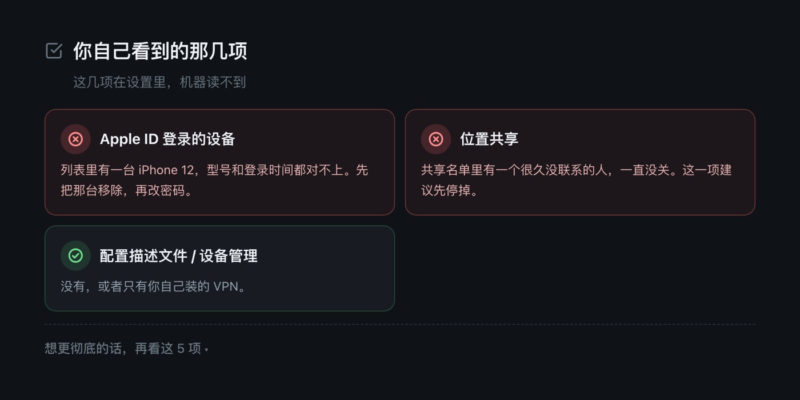

# 手机体检 · phone-privacy-audit

插上数据线，跑一条命令，看清手机里谁在动你的东西。

支持 **Android / HarmonyOS / iPhone**，全程只读，输出一份普通人能看懂的 HTML 报告。

macOS、Linux、Windows 都能跑，同一份代码、同一条命令。

> 只诊断，不代劳。不卸载、不改设置、不替你点任何按钮。



---

## 它解决什么问题

装个清理大师能清缓存，但它回答不了真正的问题：**这个软件凭什么能看我的屏幕。**

这个问题不在缓存里，在权限里。所以这个工具做的事只有一件：

把手机里每个应用的**权限、后台能力、安装来源、网络行为**摊开，逐条归因，然后画成一张图——哪个能看屏幕、哪个能读通知、哪个一直知道你在哪、哪个删不掉。

适合：

- 给爸妈的手机做一次体检（预装软件、弹窗广告、越用越慢）
- 自己手机里装了一堆说不清来路的软件
- 怀疑手机被跟踪、被监控，想先自己看一眼
- 收了一台二手设备，想确认里面干净

## 它不做的事

| 不做 | 为什么 |
|---|---|
| 不卸载任何东西 | 一个能替你卸载的工具，也能替你装东西。这个口子不该开 |
| 不改权限、不改设置 | 你才知道自己改了什么 |
| 不联网上传数据 | 采集结果和报告只留在你自己电脑上 |
| 不给安全评分 | 「66 分」对普通人毫无意义，只会让人以为手机快完了 |
| 不当杀毒软件 | 没有病毒库，只看行为与权限有没有说不通的地方 |

## 三步用起来

**第一步，拿到代码。**

```bash
git clone https://github.com/ZBoxMan/phone-privacy-audit.git
cd phone-privacy-audit
```

GitHub 连不上就下压缩包，见下面的[国内怎么下](#国内网络怎么下)。

**第二步，装依赖。只有 iPhone 需要：**

```bash
# macOS / Linux
python3 -m venv .venv
.venv/bin/pip install -r requirements.txt
```

```bat
:: Windows
python -m venv .venv
.venv\Scripts\pip install -r requirements.txt
```

安卓和鸿蒙跳过这一步，系统自带的 python 就够。

**第三步，插上手机，跑一条命令：**

```bash
# macOS / Linux
python3 scripts/run.py ./phone-audit
```

```bat
:: Windows，双击仓库里的 run.bat 也行
run.bat
```

它自己认手机：iPhone 走 USB，安卓 / 鸿蒙走 adb / hdc。采集、归因、出报告一次跑完，20–60 秒。

产物在 `./phone-audit/`：

```
phone-audit/
├── raw/            原始采集结果（纯文本，可自己 grep）
├── audit.json      归因后的结构化数据
└── report.html     给人看的报告，双击打开
```

> `scripts/run.sh` 是同一个东西的旧入口，还留着，但新代码都在 `scripts/run.py`——Windows 上没有 bash，逻辑写死在 shell 里等于把 Windows 用户关在门外。

### 各平台准备

| 平台 | 需要 | 手机上要做什么 |
|---|---|---|
| Android | [adb](https://developer.android.com/tools/releases/platform-tools) | 开发者选项 → 打开 USB 调试 → 插线后点「允许」 |
| HarmonyOS 2/3/4 | adb | 同上 |
| HarmonyOS NEXT | `hdc`（DevEco Studio 自带） | 打开开发者模式 → 允许调试 |
| iPhone | 见下 | 插线后点「信任此电脑」，**手机上不用装任何东西** |

Windows 上的两处不一样：

- `adb` 要从 platform-tools 压缩包里解出来，把那个目录加进 PATH
- iPhone 要先装 iTunes（或者只装苹果的「Apple Mobile Device Support」驱动），否则电脑认不出手机

iPhone 需要 `pymobiledevice3`，装在仓库自带的 `.venv` 里：

```bash
python3 -m venv .venv
.venv/bin/pip install -r requirements.txt
.venv/bin/python -m pymobiledevice3 usbmux list   # 确认能看到设备
```

## 国内网络怎么下

GitHub 有时候打不开。三条备选，按顺手程度排：

1. **说明页上直接下**（国内可直连）：
   <https://phone-checkup.app.workbuddy.host/?sharecode=5HBPD2YF6U>
   点「下载 zip」，拿到的是完整仓库压缩包，解压就能用，不用 git、不用代理。
   （托管方网关不放行 `.zip` 直链，所以那个按钮是页面里现拼出来的，慢一两秒正常。）
2. **GitHub Release**：<https://github.com/ZBoxMan/phone-privacy-audit/releases/latest>
   和上面同一份东西，走 GitHub 的 CDN。
3. **先看再下**：同一个说明页里有两份脱敏样例报告，不插线就能看报告长什么样。

pip 装 `pymobiledevice3` 慢的话换国内镜像：

```bash
.venv/bin/pip install -r requirements.txt -i https://pypi.tuna.tsinghua.edu.cn/simple
```

想要 Gitee 镜像也行——Gitee 支持从 GitHub 一键导入，导入后打开「强制同步」，但**别把导入的仓库当主仓**，改动还在 GitHub 这边发。

## iPhone 那三项，机器读不到

iOS 的沙箱决定了：能自动读到的是**它声明要什么**，不是你**真的给了什么**（授权状态在 TCC 数据库里，不越狱读不到）。

所以 iOS 上工具会自动读：

- 应用清单、版本、安装来源（App Store / TestFlight / 描述文件 / 来源不明）
- 每个应用在 Info.plist 里声明的隐私权限
- 后台运行能力（后台定位、后台放音、后台刷新、voip）
- 能探测多少种其他 App（`LSApplicationQueriesSchemes`）
- VPN / 网络扩展权限

剩下三项必须你自己在设置里看，报告里会留成待核对：

1. 设置 → 通用 → VPN 与设备管理：有没有不认识的描述文件
2. 设置 → 点你的名字 → 设备列表：有没有不认识的设备
3. 查找 → 我 → 共享我的位置：共享给了谁

如果配合 AI agent 使用，直接截这三张图给 agent 看就行，`scripts/grab_shots.py` 会把截图从相册里只读拉出来（iPhone 截图是 PNG，相机照片是 JPG/HEIC，不会混）。

```bash
.venv/bin/python scripts/grab_shots.py ./phone-audit/shots --minutes 30
```

## 判分口径

不是线性累加——那样「无图标 + 侧载 + 悬浮窗 + 要了几个权限」的普通软件会轻易破表，结果就是「什么都高危」，等于没有报告。

```
得分 = 最强信号 + 0.6 × 其余信号之和 × 来源系数
```

来源系数：系统应用 0.75、商店来源且有桌面图标 0.62、有图标但来源不明 0.85、其余 1.0。

分档：`≥65` 要处理 / `32–64` 待查看 / `15–31` 知道就行 / `<15` 不进报告。

规则清单（`R_ADMIN`、`R_A11Y`、`R_CAMO`、`R_NOTIF`、`R_BG_LOC`…）和每条的依据见 [references/rules.md](references/rules.md)。

**硬过滤**：可信来源 + 桌面可见 + 没有驻留特征 → 直接不进报告。微信有一条「不是从商店装的」不是给用户看的东西，是噪音。

## 报告长什么样

两份真实样例（数据已脱敏），不用插线就能先看：

- 安卓：[docs/report-android.html](docs/report-android.html)
- iPhone：[docs/report-ios.html](docs/report-ios.html)
- 使用说明页：[docs/index.html](docs/index.html)

报告里每个可疑软件占一张卡片，卡片上一排小方块，一个方块就是它能干的一件事。



## 当作 AI agent 技能用

仓库根目录的 [SKILL.md](SKILL.md) 就是技能定义，可以直接放进 WorkBuddy / Claude Code 的技能目录：

```bash
git clone https://github.com/ZBoxMan/phone-privacy-audit.git ~/.workbuddy/skills/phone-privacy-audit
cd ~/.workbuddy/skills/phone-privacy-audit
python3 -m venv .venv && .venv/bin/pip install -r requirements.txt
```

之后对 agent 说一句「体检一下手机」就够了：认机型、采集、归因、看截图、出报告都由它做。

## 局限（必须说清楚）

- **不是杀毒软件**，没有病毒库比对，只看行为与权限有没有说不通的地方
- 看到的是**检查那一刻**的状态，过后会变
- 「不是商店装的」「要了敏感权限」**本身不等于有问题**，是线索不是结论
- 采集失败的项目不等于安全，只等于没看到
- **iPhone 看不到授权状态**，只看到软件声明要什么
- **纯血鸿蒙能读到的信息非常有限**，报告会以手工核对为主
- 这是一次性体检，不是持续防护

## 发现真的有问题时

顺序不能反，删在前面会毁掉证据：

1. 先截图：应用详情页、权限页、流量记录，每一页都截
2. 涉及人身安全的（被跟踪、被定位、被控制），先断网、保留原机，交给能判断的人
3. 用另一台设备改掉账号密码，开启两步验证
4. 确认可以处理了，再按 [references/guidebook.md](references/guidebook.md) 里的路径操作

## 目录结构

```
.
├── run.bat                     Windows 入口：双击就跑
├── SKILL.md                    技能定义：规矩、分寸、话术
├── scripts/
│   ├── run.py                  一条命令跑完（自动认机型，三平台同一份）
│   ├── collect_common.py       找工具、带超时跑只读命令、写采集清单
│   ├── collect_android.py      adb，约 30 个只读数据源
│   ├── collect_harmony.py      hdc，纯血鸿蒙走这条
│   ├── collect_ios.py          pymobiledevice3，async
│   ├── run.sh                  兼容入口，内部 exec run.py
│   ├── collect_android.sh      同上
│   ├── collect_harmony.sh      同上
│   ├── grab_shots.py           从相册只读拉截图（iPhone 核对用）
│   ├── write_manifest.py       采集清单的命令行入口
│   ├── analyze.py              规则引擎入口
│   ├── phoneaudit/             规则引擎本体
│   │   ├── vocab.py            词表：包名 → 人话、可信来源、敏感权限
│   │   ├── scoring.py          计分与分档
│   │   ├── android.py          安卓/鸿蒙（AOSP）解析 + 13 条规则
│   │   ├── ios.py              iPhone 来源判定 + 8 条规则
│   │   ├── harmony.py          纯血鸿蒙（只有清单）
│   │   ├── verdict.py          一句话结论
│   │   └── pipeline.py         主流程，写 audit.json
│   └── build_report.py         模板 + 数据 → 自包含 HTML
├── assets/report.template.html 报告模板（内联 SVG，零外部请求）
├── references/
│   ├── rules.md                评分口径、规则表、禁用表述
│   ├── guidebook.md            各厂商设置路径
│   ├── manual-items.json       iPhone 人工核对项（文案唯一来源）
│   └── audit-prompts.md        补充排查提示词
├── tests/                      规则引擎回归测试 + 入口测试 + 三套脱敏夹具
└── docs/                       样例报告与说明页
```

## 开发

规则引擎不碰设备，用 `tests/fixtures/` 里的采集结果就能跑：

```bash
python3 -m unittest discover -s tests -v
```

改了规则或词表，先跑这一条。夹具是手写的脱敏数据，不含任何真实设备信息。

`tests/test_cli.py` 里有两类容易被改坏的承诺，做成了断言：

- **只读**：采集清单里不能出现 `pm uninstall`、`settings put`、`appops set` 这类写操作
- **跨平台**：venv 在 `bin/` 还是 `Scripts/` 都找得到，`--rebuild` 在没有采集结果时必须报错而不是出一份空报告

CI 在 Ubuntu 和 Windows 上各跑一遍，Python 3.9 和 3.12。Windows 那一路是专门盯着「别再写出只能在 bash 里跑的东西」。

## 隐私

- 采集全程只读，脚本里没有任何写操作（`pm uninstall` / `appops set` / `settings put` 一律没有）
- 不联网，不上传，报告是本地自包含 HTML
- `raw/` 里是你的真实应用列表，**分享报告前先想一下**，里面会有你装了什么

## License

MIT
